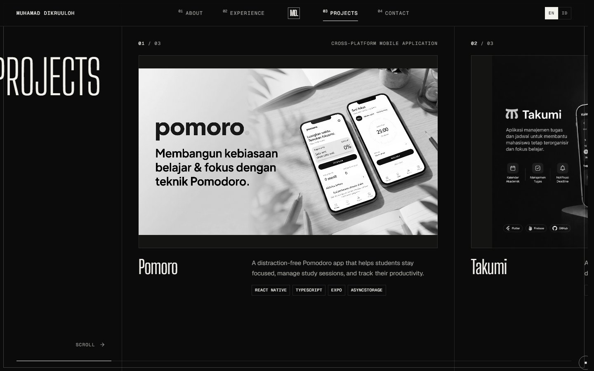
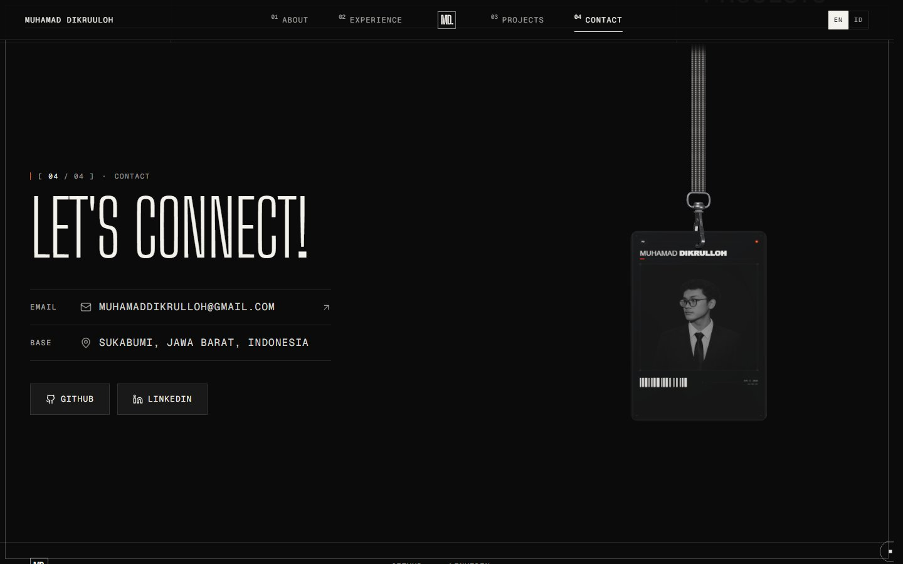

# Muhamad Dikrulloh

### Pengembang aplikasi web dan mobile

Portfolio pribadi yang mempertemukan proyek, proses belajar, dan pendekatan saya dalam membangun aplikasi: fungsional, terstruktur, dan nyaman digunakan.

Berbasis di Sukabumi, Indonesia, saya berfokus pada pengembangan web dan mobile dengan perhatian pada hubungan antara antarmuka, fitur, dan arsitektur aplikasi.

**[Kunjungi portfolio](https://mdikrulloh.informatika24b.my.id/)** · [Jelajahi proyek](https://mdikrulloh.informatika24b.my.id/projects) · [Lihat CV](https://mdikrulloh.informatika24b.my.id/cv)

## Tentang portfolio

Website ini menjadi ruang untuk mengenal karya dan cara saya bekerja. Presentasinya menggunakan nuansa gelap, tipografi tegas, serta aksen oranye, dengan interaksi yang menyatukan setiap bagian halaman.

Dari potret ASCII yang merespons kursor hingga galeri proyek, setiap bagian membawa pengunjung dari pengenalan singkat menuju detail karya. Konten tersedia dalam Bahasa Indonesia dan Inggris, dengan tata letak responsif, navigasi keyboard, serta dukungan preferensi pengurangan gerakan.

## Proyek pilihan

Aplikasi web, aplikasi mobile, dan konsep antarmuka ditampilkan melalui kurasi proyek pada halaman utama. Di desktop, bagian ini menggunakan navigasi gulir horizontal; arsip proyek menyediakan deskripsi, teknologi yang digunakan, dan galeri gambar untuk penelusuran lebih lanjut.

## Di dalam website

| Bagian | Yang dapat dijelajahi |
| --- | --- |
| **Profil dan bidang pengembangan** | Perkenalan, pendekatan kerja, keterampilan, dan pengalaman. |
| **Arsip proyek** | Daftar karya beserta konteks, teknologi, galeri, dan tautan repositori jika tersedia. |
| **Sertifikat** | Galeri berputar dengan tampilan detail sertifikat. |
| **CV** | Pratinjau dokumen, unduhan PDF asli, dan fungsi cetak. |
| **Kontak** | Email, profil profesional, dan kartu identitas 3D yang dapat ditarik dengan simulasi tali. |

### Sertifikat dan kontak

| Detail sertifikat | Kartu identitas interaktif |
| --- | --- |
|  |  |

## Teknologi

**Laravel · Filament · Inertia · React · TypeScript · Vite**

- **Laravel dan MariaDB** menangani aplikasi, penyimpanan konten, metadata publik, dan HTML awal.
- **Filament** menyediakan panel pengelolaan proyek, sertifikat, CV, dan informasi portfolio.
- **Inertia, React, dan TypeScript** menghubungkan antarmuka interaktif dengan backend PHP.
- **GSAP, ScrollTrigger, dan Lenis** mengatur animasi serta pengalaman gulir.
- **Three.js dan Canvas** menghadirkan kartu identitas 3D, potret ASCII, dan interaksi visual.
- **PDF.js** mendukung alur penayangan dokumen dan pencetakan CV.

Aset frontend dikompilasi menggunakan Vite. Deployment produksi berjalan dengan PHP tanpa server Node.js atau proses SSR terpisah. Identitas tipografi menggunakan Big Shoulders Display, Geist, dan Geist Mono.

## Tentang repositori ini

Repositori ini memuat kode sumber aplikasi, aset statis yang diperlukan, migrasi database, dan konfigurasi build. Kredensial, isi database produksi, dokumen unggahan CMS, dependensi hasil instalasi, serta aset hasil kompilasi tidak disertakan.

Konten pada website aktif dikelola melalui CMS. Instalasi dengan database baru dimulai tanpa data portfolio pribadi.

## Terhubung

- **Website:** [mdikrulloh.informatika24b.my.id](https://mdikrulloh.informatika24b.my.id/)
- **GitHub:** [muhamaddikrulloh](https://github.com/muhamaddikrulloh)
- **LinkedIn:** [Muhamad Dikrulloh](https://www.linkedin.com/in/muhamaddikrulloh)
- **Email:** [muhamaddikrulloh@gmail.com](mailto:muhamaddikrulloh@gmail.com)

---

Seluruh cuplikan tampilan di atas diambil langsung dari website produksi, bukan mockup atau hasil build lokal.
