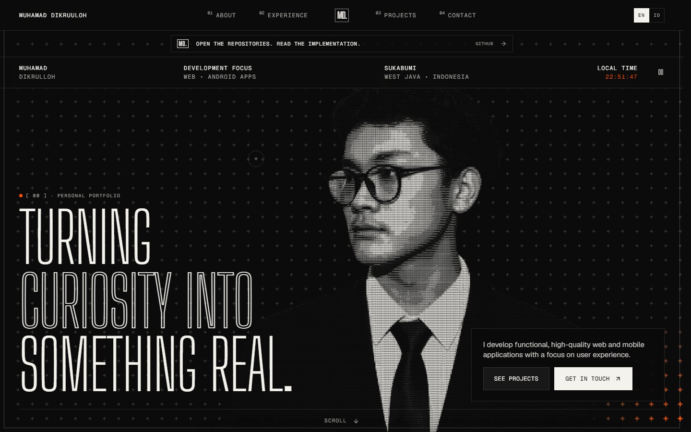
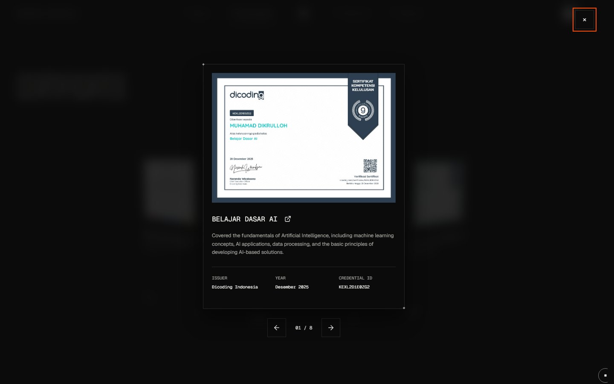

# Muhamad Dikrulloh

### Web & mobile applications. Thoughtful interfaces. Functional systems.

A personal portfolio by Muhamad Dikrulloh, a junior web and mobile app developer based in Sukabumi, Indonesia. A place to explore the work, read the thinking behind it, and get in touch.

**[Visit the live portfolio →](https://mdikrulloh.informatika24b.my.id/)**

## Curiosity, made tangible

The experience moves from an interactive portrait into a scrolling manifesto, a personal introduction, areas of practice, skills, and experience. Selected projects connect the visual presentation to a fuller archive of descriptions, technologies, and galleries.

The details matter: a portrait that responds to the pointer, a rotating certificate gallery, a resume preview with original-PDF download and print, and an interactive hanging ID card. English and Indonesian are available throughout, alongside keyboard interaction and reduced-motion support.

## Selected work

Web applications, mobile apps, and interface concepts—presented with image reveals and a horizontally scrolling selection on desktop. The project archive provides the context behind each piece of work.

## Beyond the projects

Certificates open into a focused viewing experience. The resume has its own preview, while the contact section brings together public professional links and a draggable 3D ID card with a simulated ribbon.

| Certificates | Get in touch |
| --- | --- |
|  |  |

## Built with

**Laravel · Filament · Inertia · React · TypeScript · Vite**

Laravel serves the application, public metadata, and initial semantic HTML. Filament manages portfolio content; Inertia connects the PHP backend to the React interface. GSAP and ScrollTrigger coordinate motion, Lenis handles smooth scrolling, and Three.js powers the ID card. Canvas rendering supports the portrait and image interactions; PDF.js supports document viewing and print workflows.

The frontend compiles to static assets. Production runs on PHP with MariaDB, without a Node.js server or SSR daemon. Typography uses Big Shoulders Display, Geist, and Geist Mono.

This repository contains the application source and build configuration. Private CMS records, uploaded documents, credentials, generated dependencies, and compiled deployment assets are intentionally not published. The live website shows the owner's published content; a fresh database starts with empty CMS collections.

## Connect

- **Portfolio:** [mdikrulloh.informatika24b.my.id](https://mdikrulloh.informatika24b.my.id/)
- **GitHub:** [muhamaddikrulloh](https://github.com/muhamaddikrulloh)
- **LinkedIn:** [Muhamad Dikrulloh](https://www.linkedin.com/in/muhamaddikrulloh)
- **Email:** [muhamaddikrulloh@gmail.com](mailto:muhamaddikrulloh@gmail.com)

---

All previews above are screenshots of the live production website—not mockups or local builds.
